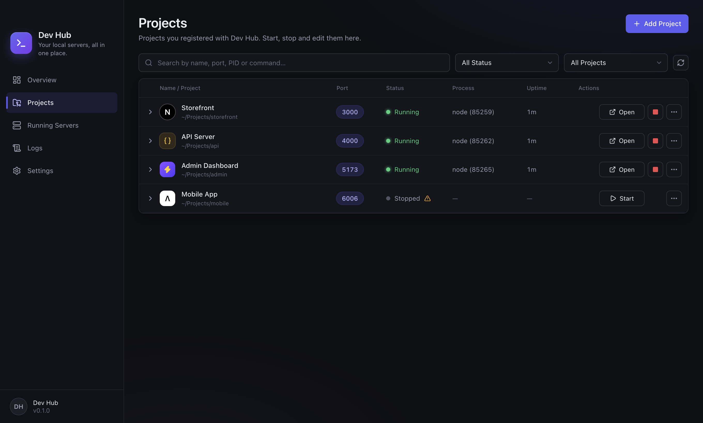

# Dev Hub for macOS

Dev Hub is a free menu-bar app that shows every development server listening on your Mac, which port it uses and which project it belongs to. Open or copy a server's URL in one click, start and stop your projects, and read their logs.

This repository hosts **release downloads only**. Dev Hub is proprietary software; its source code is not published.



## Download

Get the latest `Dev-Hub-<version>-arm64.dmg` from [Releases](../../releases).

- Requires macOS 12 or later on Apple Silicon.
- Builds are signed with an Apple Developer ID and notarized by Apple.
- Each release includes `SHA256SUMS.txt`:
  ```sh
  shasum -a 256 -c SHA256SUMS.txt --ignore-missing
  ```

## Install

1. Open the DMG and drag **Dev Hub** into **Applications**.
2. Open Dev Hub. Its icon appears in the menu bar and the dashboard opens.

To update, download the new DMG and replace the app in Applications. Your projects and settings are kept.

## Uninstall

Quit Dev Hub, move it to the Bin, and optionally delete `~/Library/Application Support/Dev Hub`, `~/Library/Logs/Dev Hub` and `~/Library/Preferences/ma.yassineoujaa.devhub.plist`.

## Privacy

Dev Hub works offline. It has no account, analytics or telemetry. See [PRIVACY.md](PRIVACY.md).

## Feedback and bugs

Open an [issue](../../issues) with your macOS version, Dev Hub version (Settings → About) and steps to reproduce. Report security issues privately via **Security → Report a vulnerability**.

## License

Free to use under the [End User License Agreement](EULA.md).
